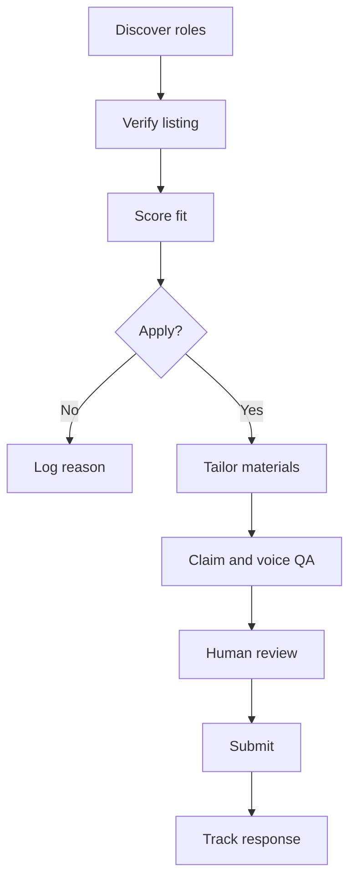

# AI Job Application Engine

A human-in-the-loop system for finding, evaluating, tailoring, and tracking job applications without turning the candidate into beige AI paste.

This repository documents the public, reusable layer of the workflow I use with AI assistants during my job search. It treats an application as a small evidence-and-positioning system:

1. Find plausible roles.
2. Verify the live posting and application route.
3. Grade fit against a controlled candidate fact set.
4. Tailor the resume selectively.
5. Write a cover letter in a recognizable human voice.
6. Answer screening questions with the same evidence and claim boundaries.
7. Require human review before anything is submitted.
8. Log the outcome and watch for follow-up.

The aim is not to spray generic applications at the internet faster. The aim is to remove repetitive production work so a human can spend more time on judgment, research, honest positioning, and the applications that are actually worth sending.

## What this demonstrates

- Agent and skill design
- Prompt and context engineering
- Evidence-grounded resume tailoring
- Human voice preservation
- Privacy-aware workflow design
- Job-fit scoring and prioritization
- Document QA and cross-application consistency
- Human approval gates for consequential actions

## Architecture



## Repository map

```text
.
├── skill/job-application-engine/SKILL.md
├── skill/job-application-engine/references/
│   ├── application-workflow.md
│   ├── cover-letter-strategy.md
│   ├── job-discovery-and-fit.md
│   ├── privacy-and-claim-safety.md
│   ├── resume-tailoring.md
│   ├── seo-assessment-framework.md
│   └── voice-guide.md
├── templates/
│   ├── candidate-facts.example.md
│   ├── job-fit-scorecard.md
│   └── professional-story.example.md
├── scripts/redact_check.py
├── tests/test_redact_check.py
└── config.example.yaml
```

## The important design choice

Candidate facts are separated from application logic. The public repository contains the process, writing rules, scorecards, and safety checks. My private implementation supplies the real resume, contact information, prospect log, professional stories, compensation strategy, and employer-specific drafts at runtime.

That separation helps prevent three common failures:

- inventing or mutating career facts to match a posting;
- leaking private job-search data into a public repository;
- letting a generic model voice flatten the candidate into everyone else.

## Quick start

1. Copy `config.example.yaml` to a private configuration file outside the repository.
2. Create a private candidate fact sheet using `templates/candidate-facts.example.md`.
3. Install or invoke the skill in `skill/job-application-engine/` with your preferred AI agent.
4. Give it a live job posting and ask for a fit assessment before requesting document edits.
5. Run the redaction check before committing public examples:

```bash
python scripts/redact_check.py .
python -m unittest discover -s tests
```

## Principles

- Evidence before keywords.
- Tailor selectively; do not rewrite for the sake of activity.
- Approximate honestly and preserve measurement qualifiers.
- A cover letter should interpret the resume, not narrate it again.
- AI may draft, compare, inspect, and automate. A human owns claims, judgment, and submission.
- “Optional” cover letters are treated as useful when they add context and the application accepts one.
- No application is submitted without a final human approval gate.

## Privacy

This repository intentionally excludes real resumes, application packets, prospect logs, email correspondence, phone numbers, addresses, compensation answers, proprietary dashboards, and employer-specific drafts. See `skill/job-application-engine/references/privacy-and-claim-safety.md`.

## License

MIT. Use it, adapt it, and make it sound like an actual person.

